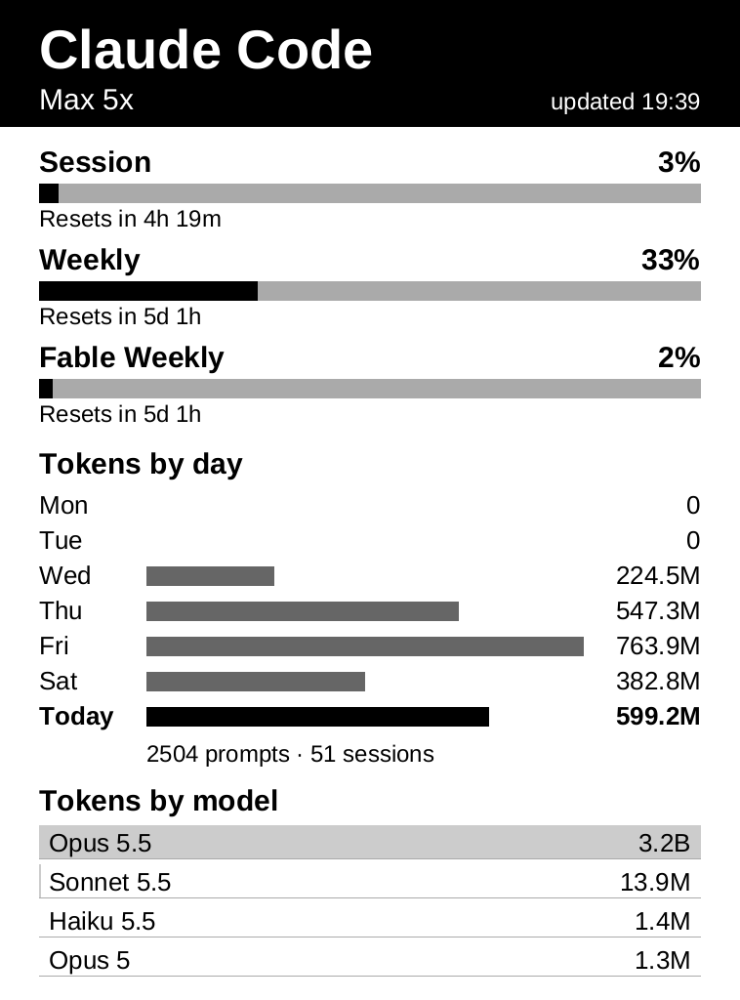

# kindle

A jailbroken Kindle Paperwhite 2 used as an e-ink dashboard, plugged into a Linux PC by USB.
The PC gives the Kindle a network and internet access over the cable, and small static Rust
programs draw straight to the e-ink panel.



The first real app shows Claude Code usage (rate limits, tokens per day, tokens per model),
the same numbers [Omarchy](https://omarchy.org)'s agents panel shows on the desktop.

## What is here

| Path | What it is |
|---|---|
| `crates/eink/` | Rust library: an 8-bit gray canvas, TrueType text (Liberation Sans), and the panel refresh ioctls |
| `crates/hello/` | Test page: proves the cross-build and the refresh path |
| `crates/usage/` | The dashboard: the bead being worked on, read page by page, and Claude Code usage |
| `crates/watch/` | `kindle-watch`, the PC side: watches every br workspace and pushes the bead in progress |
| `host/` | Scripts that run on the PC: build and run an app, collect and push usage, install the Kindle's jobs, verify the link; the watcher's user unit and its check |
| `kindle/` | Files that run on the Kindle: the uplink upstart job and the link self-check |

## The device

Kindle Paperwhite 2 (2013, Wi-Fi), firmware 5.12.2.2: an i.MX6 SoloLite (ARMv7, Cortex-A9)
running Linux 3.0.35 with a soft-float (armel) userland and an old glibc. The panel is
758×1024 at 212 dpi, 16 gray levels.

It was prepared with community tools, none of which are in this repo:

- WinterBreak ([guide](https://kindlemodding.org/jailbreaking/WinterBreak/),
  [thread](https://www.mobileread.com/forums/showthread.php?t=365372)) to jailbreak it, with
  the OTA updater disabled afterwards so an update cannot undo it
- [KUAL](https://www.mobileread.com/forums/showthread.php?t=203326) and MRPI to install packages
- USBNetwork, from [NiLuJe's hacks](https://www.mobileread.com/forums/showthread.php?t=225030),
  which turns the USB port into an Ethernet link with an SSH server (dropbear) on the Kindle

Other models and firmware need different jailbreaks, and the panel ioctls differ between
generations (see [Drawing on the panel](#drawing-on-the-panel)).

## The USB link

With USBNetwork enabled the Kindle is `192.168.15.244` and the PC is `192.168.15.201` on a
`/24`. The Kindle's Wi-Fi stays off; everything goes through the cable.

### PC side

Three pieces, shown as they are deployed on the author's machine (Arch Linux with
NetworkManager and nftables).

A stable interface name, whatever USB port or gadget driver the Kindle comes up with, in
`/etc/systemd/network/60-homelab-kindle.link`:

```ini
[Match]
Property=ID_VENDOR=Linux_3.0.35-lab126_with_fsl-usb2-udc

[Link]
Name=kindle0
```

The PC's address on the link, never a default route, in
`/etc/NetworkManager/system-connections/homelab-kindle.nmconnection` (mode 0600):

```ini
[connection]
id=homelab-kindle
type=ethernet
interface-name=kindle0
autoconnect=true

[ipv4]
method=manual
address1=192.168.15.201/24
never-default=true

[ipv6]
method=disabled
```

IPv4 forwarding (`net.ipv4.ip_forward = 1`), and these rules in the input, forward and NAT
postrouting chains of an nftables `inet` table. The forward rule keeps the Kindle off the
author's Tailscale network; drop that clause if you have none.

```
iifname "kindle0" accept
iifname "kindle0" oifname != "tailscale0" accept
ip saddr 192.168.15.0/24 oifname != "kindle0" masquerade
```

### Kindle side

The Kindle needs a default route through the PC and DNS resolvers.
`kindle/upstart/kindle-uplink.conf` sets both every time USBNetwork starts (resolvers
`1.1.1.1` and `8.8.8.8`). Install it once:

```sh
host/install-job.sh kindle-uplink   # copies kindle/upstart/kindle-uplink.conf to /etc/upstart/
```

The stock firewall (`/etc/sysconfig/iptables`, loaded by the `network` job) drops new
connections on every interface but `usb0`. `kindle/upstart/firewall-open.conf` runs after it
and accepts everything, so with Wi-Fi on the Kindle is reachable on the LAN, telnet included:

```sh
host/install-job.sh firewall-open
```

All the scripts reach the Kindle as `ssh kindle`, so add a host entry:

```
Host kindle
    HostName 192.168.15.244
    User root
    IdentityFile ~/.ssh/id_ed25519_kindle
    IdentitiesOnly yes
```

### Check it

```sh
host/verify-link.sh
```

It exits 0 only if all five checks pass. It sets nothing up itself, so a pass means the
setup holds on its own:

| Check | What it proves |
|---|---|
| `host_to_kindle` | the PC reaches the Kindle over SSH |
| `wifi_off` | the Kindle's Wi-Fi is off, so the remaining checks can only pass over USB |
| `default_route_usb0` | the Kindle's default route is the USB link |
| `kindle_to_host` | the Kindle fetches a random token the PC serves for this run |
| `internet_via_usb` | the Kindle fetches `https://example.com/` (or `$INTERNET_URL`) from its USB address |

## Building and running apps

The apps are cross-compiled for `armv7-unknown-linux-musleabi`: statically linked against
musl, so the Kindle's old glibc never matters, and soft-float to match its ABI.
`rust-toolchain.toml` installs the target, and `.cargo/config.toml` links with `rust-lld`,
so no ARM C toolchain is needed.

```sh
host/run-app.sh hello   # build, copy to /mnt/us/kindle-dev/ on the Kindle, run over ssh
cargo test              # tests run on the PC; nothing in them needs the device
```

`hello` draws a banner, the framebuffer geometry and a 16-step gray ramp.

## Claude Code usage

`usage` draws what Omarchy's agents panel shows for Claude Code: the plan, each rate
limit's meter and reset countdown, tokens per day for the last week summed over every
machine that runs Claude Code (today in bold, with devbox's prompt and session counts),
and the four heaviest models.

The page is landscape, for a Kindle standing on its long edge. The ☰ button at the top
right opens a menu:

- **Orientation**: *USB left* or *USB right*, the side the Kindle's USB port is on. The
  PW2 has no accelerometer (its firmware's `accelerometer` property always reads `U`), so
  it cannot tell which way it is turned. The page is drawn at 1024×758 and turned in
  software (`Canvas::upright` in `eink`) before it reaches the portrait framebuffer.
- **Light**: −, + (steps of 3 on powerd's 0–25 scale) and Off/On, which remembers the
  level.
- **Exit to Kindle**: gives the screen back to the Kindle's own UI until the next reboot.

Both choices are saved in `/mnt/us/kindle-dev/usage.settings` and survive restarts.

### How it runs

`usage serve` runs on the Kindle and owns the screen. It reads touches from
`/dev/input/event1`, takes pushes on the Unix socket `/var/run/usage.sock`, and feeds both
through one pure state machine (`crates/usage/src/app.rs`) whose effects (draw, set the light,
save) the shell carries out. devbox pushes, and `usage push` fails loudly if the daemon is
not running:

```sh
host/push-usage.sh          # send the usage record to the dashboard
host/push-usage.sh --flash  # the same, with a full refresh that clears ghosting
```

- The data is Omarchy's own record, `~/.local/state/omarchy/agents/usage/claude.json`,
  which its collector rewrites about every 15 minutes. The record travels over SSH, so the
  PC opens no port.
- Omarchy's record only knows devbox, so `host/tokens-by-day.sh` replaces its tokens per
  day with [ccusage](https://github.com/ccusage/ccusage)'s: `ccusage claude daily` on
  devbox and, over SSH, on every host in its `REMOTES` (fedora), summed per date in
  devbox's time zone, the last seven dates always present and zero when idle. Each host
  needs `npm i -g ccusage`; a global install also ends `npx ccusage@latest`'s download
  prompt at every new release (ccusage itself checks for no updates). An unreachable host
  is left out of the sum, with a line in the timer's journal; the push goes on.
- The PC's clock is the only clock: each push carries its time and UTC offset, and redraws
  between pushes run that time forward. Countdowns and the "today" row come from it.
- A systemd user timer runs the push every 5 minutes. Refreshes are quiet except in the
  first five minutes of each hour, when a full flash clears e-ink ghosting.

### The bead being worked on

The header is a tab strip: **Bead** and **Usage**, with ☰ at the right. Tapping a tab shows
it; the usage dashboard is the Usage tab. The Bead tab shows the bead in progress on devbox:
its project and id, title, priority, type and assignee, then its description, rendered from
Markdown by [franken_markdown](https://github.com/igouss/franken_markdown) (pinned to a
commit of the fork in the workspace manifest). It says "Nothing in progress" when there is
none, and "Waiting for devbox" until the first bead push since the dashboard started.

The description reads like a book, a page at a time:

- Tap the left third of the page to go back, the right two thirds to go forward.
- When it runs past one page, a scroll bar at the right shows where you are, and the header
  shows how long the bead has been in progress and the page, as in `42m · 3 of 6`.
- A line never splits across pages, and a heading never ends one.
- Page turns refresh quietly; every sixth turn flashes to clear e-ink ghosting.
- The page count is worked out once per push, from the same layout that draws the page;
  time lives in the header so the layout depends only on the bead.

A bead push carries a payload: the bead in progress, or `null`, and its epic, or `null`:

```sh
ssh kindle /mnt/us/kindle-dev/usage bead --now "$(date --iso-8601=seconds)" < payload.json
```

```json
{"bead":{"project":"kindle","id":"kindle-bxx.4","title":"…","priority":1,"issue_type":"task",
         "assignee":"elendal","started":"2026-10-26T09:00:00-04:00","description":"markdown"},
 "epic":{"id":"kindle-bxx","title":"…","beads":[{"id":"kindle-bxx.4","title":"…","status":"in_progress"}],
         "blocks":[["kindle-bxx.3","kindle-bxx.4"]]}}
```

`blocks` pairs run from the blocker to the bead it blocks. A status the dashboard does not know
is kept as "other" rather than refused, so a new br status cannot break pushes.

- A bead with a new id opens the Bead tab at its first page and closes the menu, with a full
  flash; the same id pushed again replaces what was known of it and keeps the reading
  position (or the last page, if the description got shorter); `null` leaves the tab where
  it is.
- A push redraws only the tab it changes, if that tab is showing.
- `started` and `--now` must be RFC 3339; a snapshot that is not a bead or `null` is refused
  before it reaches the socket.

### The watcher

`kindle-watch` runs on the PC and makes those pushes. br has no hooks by design, so the
watcher uses inotify on every `.beads/` workspace under `~/Projects` (except paths containing
`/tests/` or `temp_test`), and picks up new workspaces once a minute.

- It wakes only on `MODIFY` and `MOVED_TO` of the files that carry bead state (names ending
  `.db`, `.db-wal` or `.jsonl`). Its own read-only queries must never wake it, or it queries
  itself forever: br's reads raise `CLOSE_WRITE` on the database files, and on an old-schema
  database they also write an anonymous temp file (`#18187483`) in `.beads/`.
- After half a second of quiet it asks each changed workspace, read-only, for its beads in
  progress, and when each moved to in progress (`br audit log`). The newest across all
  workspaces is pushed with its description and its epic: its parent's children with their
  statuses and the blocking edges among them (a bead with no parent stands for its own
  children, or for itself alone). When nothing is in progress, the bead is `null` and the
  epic is the last one shown, read again, so the bead that just closed shows as closed.
- It pushes only when that changes, and again every five minutes, so a restarted Kindle
  catches up and the elapsed time stays honest. An unreachable Kindle is logged and tried
  again a minute later.
- The snapshot's shape is a contract: `crates/watch/src/snapshot/wire.json` is what the
  watcher's test must produce and what the dashboard's test must decode.

```sh
cargo install --locked --path crates/watch
systemctl --user enable --now ~/Projects/mine/kindle/host/kindle-watch.service
journalctl --user -u kindle-watch -f      # queried …, pushed …
host/check-watch.sh                       # start, claim, read, close in a scratch workspace
```

`host/check-watch.sh` drives the real Kindle: it exits 0 only if a new workspace pushes
nothing, a claim pushes the bead, read-only br commands cause no query at all, a close
pushes nothing again, and a copy of an old-schema workspace (beads_rust's
`sample_beads_db_files/repro_beadsrust_import_write.*`, when present; it says SKIP when not)
is queried once and never again.

Touch only works while the Kindle is awake: in its screensaver the touch controller is in
deep sleep and raises no interrupt at all (measured: its IRQ count did not move through
several taps). Dashboard mode therefore stops the Kindle's own UI (`stop lab126_gui`) and
keeps the screensaver off (`lipc-set-prop com.lab126.powerd preventScreenSaver 1`). The
power button then changes nothing; powerd stays `Active`.

### Dashboard mode at boot

`kindle/upstart/dashboard.conf` makes the dashboard replace the Kindle UI at every boot:

```sh
cargo build --release --target armv7-unknown-linux-musleabi -p usage
scp target/armv7-unknown-linux-musleabi/release/usage kindle:/mnt/us/kindle-dev/usage
host/install-job.sh dashboard
ssh kindle touch /mnt/us/kindle-dev/dashboard.on
```

When the Kindle UI's `framework` starts, the job:

1. does nothing unless `/mnt/us/kindle-dev/dashboard.on` exists, and nothing if *Exit to
   Kindle* was chosen since boot (`/var/run/dashboard.off`, cleared at every boot);
2. waits up to 60 s for the SSH server (dropbear) and leaves the Kindle UI alone if it never
   comes up, so the device stays reachable;
3. stops the Kindle UI, turns the screensaver off and runs `usage serve`, restarting it if
   it crashes. A clean exit (*Exit to Kindle*) ends it for this boot.

### Getting the Kindle UI back

From the quickest to the most thorough:

| How | Lasts |
|---|---|
| Tap ☰, then **Exit to Kindle** | until the next reboot |
| `ssh kindle 'touch /var/run/dashboard.off; /sbin/stop dashboard; lipc-set-prop com.lab126.powerd preventScreenSaver 0; /sbin/start lab126_gui'` | until the next reboot |
| `ssh kindle rm /mnt/us/kindle-dev/dashboard.on`, then reboot (or *Exit to Kindle*, then delete `kindle-dev/dashboard.on` in USB drive mode) | for good |
| `ssh kindle 'mntroot rw; rm /etc/upstart/dashboard.conf; mntroot ro'` | for good; removes the job |

Rebooting alone does not help while the marker exists: the dashboard comes back. Holding
the power button for about 40 seconds forces a reboot if the device ever stops responding.

## Drawing on the panel

The panel is `/dev/fb0`: 8 bits per pixel, 0 black and 255 white, 758 visible pixels per row
in a 768-byte stride. Writing to it changes nothing you can see. The e-ink controller
redraws only when asked, with the `MXCFB_SEND_UPDATE` ioctl, and
`MXCFB_WAIT_FOR_UPDATE_COMPLETE` waits until it has finished.

These ioctls differ between Kindle generations. The PW2 takes the 72-byte
`mxcfb_update_data` and the 8-byte update marker from
[FBInk](https://github.com/NiLuJe/FBInk)'s `eink/mxcfb-kindle.h`. An ioctl number encodes
its struct's size, so compile-time asserts pin every struct size in `crates/eink/src/epdc.rs`. That
file is the only place `unsafe` is allowed; the workspace denies it everywhere else.

## Tests

```sh
cargo test
cargo mutants
```

The drawing code is tested on the PC. `crates/usage/golden/full.pgm` pins the dashboard's layout
pixel for pixel; after an intended layout change, look at the new page and rewrite it with
`UPDATE_GOLDEN=1 cargo test -p usage golden`. Mutation testing with
[cargo-mutants](https://mutants.rs) catches every viable mutant. `.cargo/mutants.toml`
leaves out only code that can run solely on the device: the ioctls and the programs' entry
points.

## Device notes

- Updates are blocked: `/usr/bin/otaupd` and `/usr/bin/otav3` are renamed to `*.bck`.
- USBNetwork's public package ships the same SSH host keys to everyone. Regenerate them on
  the device.
- USBNetwork starts at boot when `/mnt/us/usbnet/auto` exists. Turning it off in KUAL
  brings back USB drive mode.
- Toggle USBNetwork once and wait: toggles that overlap leave sshd stopped.
- An SSH session's `PATH` is only `/usr/bin:/bin`; call `/sbin/reboot` and
  `/usr/sbin/mntroot` by full path.
- The root filesystem is read-only: `mntroot rw` before changing anything under `/etc`,
  `mntroot ro` after.

## Credits

The jailbreak, KUAL, MRPI and USBNetwork come from the MobileRead Kindle community, and
NiLuJe's FBInk was the reference for the panel ioctls. Liberation Sans is © Google and Red
Hat under the SIL Open Font License; see `crates/eink/assets/LiberationSans-LICENSE`.
